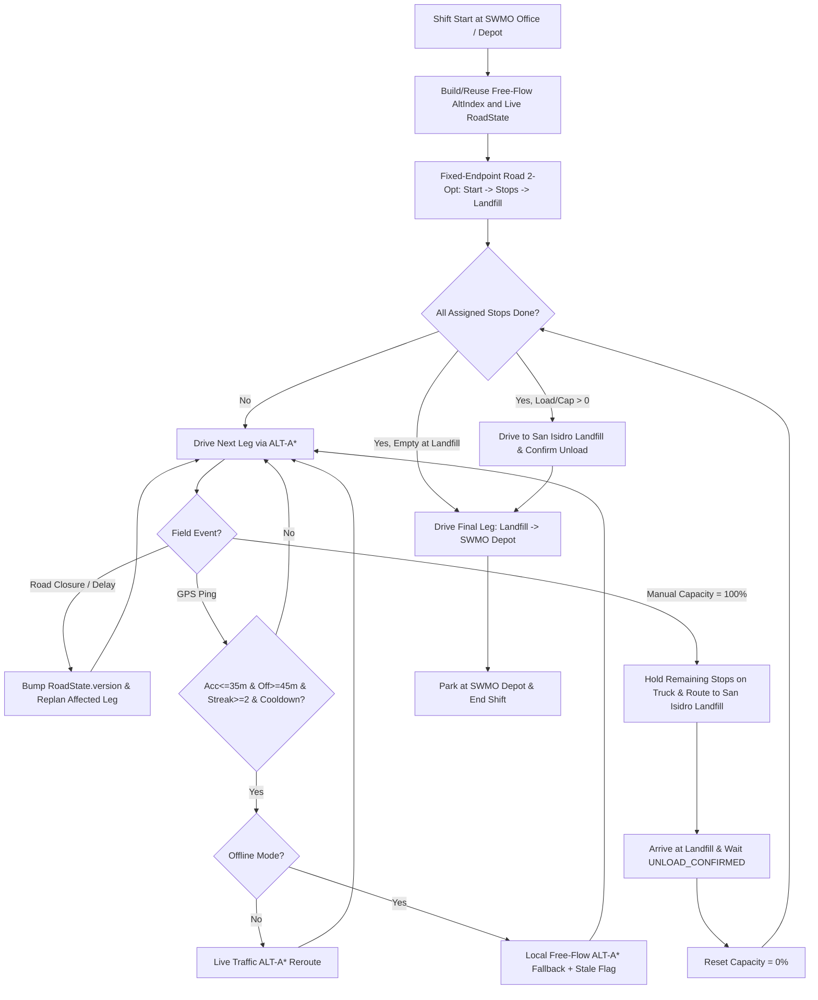
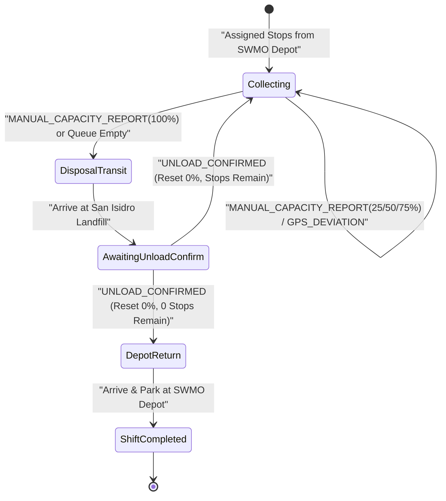

# Traffic-Aware A\* Optimization, Benchmarking, and Methodology for Solid Waste Collection in Naga City

**Document Scope:** Capstone Research Methodology, Empirical Validation, and Architecture Reference  
**Benchmark Application:** `Benchmarking ALGO` (`js/sim/routing/`, `js/sim/fleet/`, `js/sim/simulation.js`)  
**Target Production System (Integration Pending Separate Approval):** `EcoLoop` (`WebApp`, `MobileApp`, Supabase Edge Functions)  
**Verified Benchmark Snapshot:** `docs/benchmark_results.json` (generated `2026-11-25T19:37:23.924Z`)

---

## 1. Executive Overview & Confirmed Operational Scope

Solid waste collection in Naga City is operated by the Solid Waste Management Office (SWMO) using scheduled collection routes assigned to specific vehicles across 17 schedule zones (`AREA-1` through `AREA-15`, `COMPACTOR`, and `FLEET-CLEARING`) spanning 27 barangays. Operational routing must reflect real-world field constraints:

- **Fixed Endpoints & Shift Lifecycle:** Every collection shift originates at **SWMO Office / Depot** (`13.618842, 123.1995803`), services a driver's assigned stops, unloads at **SWMO Sanitary Landfill (San Isidro)** (`13.6212151, 123.2576126`) whenever truck capacity reaches `100%` or when collection completes, resumes any remaining stops held by that same truck after explicit unload confirmation (`0%` reset), and finishes by driving empty from **San Isidro Landfill $\to$ SWMO Depot** to park and end the shift.
- **No IoT Sensors / No Demand Fabrication:** Collection points have no automated fill sensors or smart-bin telemetry. Capacity monitoring relies exclusively on manual driver reports (`25%`, `50%`, `75%`, `100%`), explicit driver stop confirmation (`visited` $\neq$ `confirmed`), and explicit landfill unload confirmation. Stop allocation across multi-truck zones is assigned manually by an administrator.
- **Dynamic Field Disruptions:** Trucks traverse a directed urban road network (`14,374` nodes, `16,042` edges, `1,150` one-way streets in `data/Naga_City_boundary_roads.geojson`) subject to time-varying congestion (sourced from Mapbox Directions v5 traffic metadata online), road closures, driver GPS deviations with smartphone GPS noise, and cellular dead zones requiring local offline routing and deferred synchronization.

Empirical evaluation in the standalone benchmark simulator demonstrates that replacing baseline static/Euclidean routing with the proposed **Dynamic-Safe ALT-A\* (`FastAStarWorkspace` + `AltIndex`) + Unified Travel-Time/Elevation/Closure Cost Model + Fixed-Endpoint Asymmetric Road-Cost 2-Opt Sequencer** preserves **100.0% shortest-path optimality** across 595/595 tested Naga and elevated O-D pairs while reducing node expansions by **43.4%–68.1%** on O-D queries and **62.08%** in multi-truck citywide simulations, cutting total travel distance by **32.68%–33.08%** vs. schedule order (**5.75%** vs. Euclidean Nearest Neighbor), and reducing repeated road traversal by **25.94%–53.19%**.

---

## 2. Formal Problem Classification & Mathematical Model

### 2.1 Problem Classification

The Naga City garbage collection routing problem is formally classified as a **Hierarchical, Dynamic, Time- and Capacity-Constrained Multi-Trip Directed Path-Routing and Fixed-Endpoint Asymmetric Traveling Salesperson Problem with Recourse (Dynamic DT-ME-ATSP)**:

1. **Lower Level (Single-Pair Shortest Path on Dynamic Directed Multigraph):** Minimum generalized cost path between any truck state node and target node under time-varying arc speeds, non-negative elevation climb/descent weights, and hard road closures.
2. **Upper Level (Fixed-Endpoint Asymmetric Path-TSP per Truck Trip):** Given current node $v_0$, assigned uncollected stop set $S$, and disposal endpoint $v_D$, determine an ordered visit sequence $\pi = (\pi_1, \dots, \pi_m)$ minimizing directed road-network tour cost from $v_0 \to \pi_1 \to \dots \to \pi_m \to v_D$.
3. **Operational Control Layer (Event-Driven Recourse):** Discrete-event state transitions triggered by manual capacity `100%`, explicit `UNLOAD_CONFIRMED`, manual `STOP_CONFIRMED`/`STOP_SKIPPED`, hysteresis-filtered `GPS_DEVIATION`, road closures/delays, and `NETWORK_DISCONNECT`/`NETWORK_RECONNECT`.

### 2.2 Road Network & Unified Edge-Cost Model (`RoadState`)

Let the road network be a directed CSR graph $G = (V, A)$ with physical edge set $E$, where two-way streets produce paired opposite arcs $a, \bar{a} \in A$ and one-way streets produce a single directed arc $a = (u \to v)$. Each physical edge $e \in E$ carries physical length $L_e > 0$ (m), posted/inferred free-flow speed limit $v^{\text{free}}_e > 0$ (m/s), closure flag $b_e \in \{0, 1\}$, optional Mapbox observed speed $v^{\text{live}}_e$ (m/s), and delay factor $\mu_e > 0$.

Effective traversal speed $v^{\text{eff}}_e$ in **Unified Time Mode** (`costMode = 'time'`) is defined as:

$$
v^{\text{eff}}_e =
\begin{cases}
v^{\text{free}}_e, & \text{if offline} \\
\dfrac{\operatorname{validSpeed}(v^{\text{live}}_e, v^{\text{free}}_e)}{\mu_e}, & \text{if online}
\end{cases}
$$

The directed generalized arc cost $c(a)$ for arc $a = (u \to v)$ on physical edge $e$ with elevation difference $\Delta z_a = z_v - z_u$ and weights $(w_t, w_c, w_x) = (1.0, 0.5, 0.15)$ is:

$$
c(a) =
\begin{cases}
+\infty, & \text{if } b_e = 1 \text{ (road closed)} \\[4pt]
w_t \dfrac{L_e}{v^{\text{eff}}_e} + w_c \max(0, \Delta z_a) + w_x \max(0, -\Delta z_a), & \text{otherwise}
\end{cases}
$$

Physical driving time along an open arc is tracked strictly as $\tau(a) = L_e / v^{\text{eff}}_e$ so hill climb/descent penalties shape route selection without distorting truck kinematics or ETA predictions.

> **Naga Dataset Elevation Audit:** Direct schema inspection of `data/Naga_City_boundary_roads.geojson` (`3,878` LineStrings, `19,924` vertices) verified `0 / 19,924` 3D coordinates (`nagaHasElevation = false`). Accordingly, `cityMapLoader.js` initializes $\Delta z_a = 0$ on Naga City roads rather than fabricating hills, while synthetic terrain and future DEM-enriched exports automatically activate $(w_c, w_x)$ while keeping $h$ admissible.

### 2.3 Upper-Level Fixed-Endpoint Asymmetric Path-TSP Objective

For a truck at node $v_0$ with assigned reachable stops $S \subseteq V$ and disposal endpoint $v_D$, let $M[u][v] = C^*(u \to v)$ denote the live minimum generalized road cost between nodes $u$ and $v$. We seek a permutation $\pi$ of $S$ minimizing:

$$
J(\pi) = M[v_0][\pi_1] + \sum_{k=1}^{|S|-1} M[\pi_k][\pi_{k+1}] + M[\pi_{|S|}][v_D]
$$

Any stop $s \in S$ unreachable from $v_0$ ($M[v_0][s] = \infty$) is explicitly recorded in `unreachableStops` and kept in total coverage denominators (`binsCollected / totalAssignedStops`). Route quality along traversed arcs $T = (a_1, \dots, a_q)$ is evaluated via:

- **Unique Road Distance:** $D_{\text{uniq}} = \sum_{e \in E(T)} L_e$
- **Repeated Road Traversal Distance:** $D_{\text{rep}} = \sum_{i=1}^q L_{e(a_i)} - D_{\text{uniq}}$
- **Backtracking Distance (Immediate U-Turns):** $D_{\text{back}} = \sum_{i=2}^q \mathbb{I}[u_i = v_{i-1} \land v_i = u_{i-1} \land e_i = e_{i-1}] \cdot L_{e_i}$

---

## 3. Audit of Existing Baseline & Main System Implementations

| Capability / Component | Benchmark Baseline 1 | Benchmark Baseline 2 | Benchmark Proposed (`R01–R09`) | EcoLoop Main System (Inspected Read-Only) |
|---|---|---|---|---|
| **Graph & One-Way Support** | CSR Graph (`edgeDirected`) | CSR Graph (`edgeDirected`) | Shared CSR Graph + `AltIndex` | No local road graph (relies on remote Mapbox Directions API v5) |
| **Traffic & Closures** | Ignored in static route (`js/algorithms/astar.js`) | `length * multiplier` overlay (`RoadState`) | `length / effectiveSpeed + elev + Infinity` + `trafficAdapter.js` | Mapbox `driving-traffic` online; opaque polyline (no `annotations`) |
| **Elevation Climb / Descent** | Supported in `CostModel` | Missing in fleet `RoadState` | Unified in `RoadState` (`w_c=0.5, w_x=0.15`) | Not modeled |
| **A\* Memory & Heuristic** | Fresh `Float64Array`/`MinHeap` + Euclidean | Fresh typed arrays + Euclidean | Timestamped `FastAStarWorkspace` + `AltIndex` ($k=6$) + Versioned Path Cache | Remote API only (`<= 25` waypoints/leg) |
| **Stop Sequencing** | Fixed CSV `stop_order` (`given`) | Euclidean Nearest Neighbor | Bounded-Dijkstra Matrix + Road-Cost NN + Fixed-Endpoint Asymmetric 2-Opt | Static database `stop_order` (`streetRouteService.ts`) |
| **Capacity Workflow** | Bin-weight cross-truck handoff | Bin-weight cross-truck handoff | Manual `25/50/75/100%`, `awaiting_unload_confirm`, `0%` reset, same-truck resume | `MobileApp` manual `25/50/75/100%` + unload confirm; relief estimator still has `120 kg / 240 L` heuristic |
| **Final Depot Return** | Sanitary Landfill $\to$ SWMO Depot | Sanitary Landfill $\to$ SWMO Depot | Explicit per-leg breakdown (`collection`, `disposal`, `return`) | Trip ends at disposal / manual close |
| **GPS Deviation** | Not modeled | Road-event replanning only | Accuracy/distance/streak/cooldown hysteresis + A\* reroute | Immediate `forceRefresh` on route offset (`MapNavigateScreen.js`) |
| **Offline Fallback** | None | None | Local free-flow A\* + stale-traffic warning + offline event sync queue | `AsyncStorage` polyline cache (`~110 m` bucket) + `COMPLETE_DELIVERY` queue |

---

## 4. Proposed Algorithm & Mathematical Proofs (`R01–R09`)

### 4.1 Theorem: Admissibility & Consistency of Static Free-Flow ALT Under Dynamic Slowdowns & Closures

Let $d_f(L, x)$ and $d_f(x, L)$ be exact shortest-path costs precomputed on free-flow weights $c_f(a) = L_e / v^{\text{free}}_e + c_{\text{elev}}(a)$ for each landmark $L \in \mathcal{L}$ located in the main connected component. Define:

$$
h_{\text{ALT}}(v, g) = \max\left( h_{\text{Euc}}(v, g),\; \alpha_{\min} \cdot \max_{L \in \mathcal{L}} \max\left( d_f(L, g) - d_f(L, v),\; d_f(v, L) - d_f(g, L) \right) \right)
$$

where $\alpha_{\min} = \min_{e \in E,\, b_e=0} \min\left(1, \dfrac{v^{\text{free}}_e}{v^{\text{eff}}_e}\right)$. Under all congestion delays ($v^{\text{eff}}_e \le v^{\text{free}}_e$), road closures ($c(a) = \infty \ge c_f(a)$), and offline mode ($v^{\text{eff}}_e = v^{\text{free}}_e$), every open arc satisfies $c(a) \ge c_f(a)$ and $\alpha_{\min} = 1$. By monotonicity of shortest paths and the directed triangle inequality:

$$
C^*(v \to g) \ge C_f^*(v \to g) \ge d_f(L, g) - d_f(L, v)
$$

and symmetrically $C^*(v \to g) \ge d_f(v, L) - d_f(g, L)$. Since the maximum of consistent heuristics scaled by $\alpha_{\min} \le 1$ remains monotone, $h_{\text{ALT}}$ is **provably admissible and consistent for every road-state mutation without rebuilding landmark tables**.

### 4.2 Timestamped Search & Incremental Cost-Matrix Memoization

1. **Epoch-Stamped Typed Arrays (`FastAStarWorkspace`):** Replacing per-search `Float64Array(n).fill(Infinity)` with 32-bit epoch stamps (`seenStamp`, `closedStamp`) reduces A\* per-call reset from $\Theta(|V|)$ writes to $O(1)$ integer increment (`++stamp`).
2. **Versioned Cost + Path Cache (`Router`):** Both scalar `legCost` and cloned `arcs`/`path` arrays are cached under `start * 2^32 + goal`, automatically invalidated whenever `RoadState.version` increments, and returned as shallow array clones (`slice()`) so vehicle arc consumption (`arcs.shift()`) never mutates cached paths.
3. **Incremental Row Memoization (`buildCostMatrix`):** Stop sequencing queries only missing `(src, dst)` pairs using single-source bounded `computeDistances`, clearing `_seqMatrixCache` only on `RoadState.version` changes. Across a 40-stop vehicle tour, suffix planning drops from $\approx 820$ Dijkstras to $\le 41$.
4. **Fixed-Endpoint Asymmetric 2-Opt (`sequenceStops`):** Because Naga City has `1,150` one-way streets, reversing sub-segment $\pi[i..j]$ flips every internal directed arc $(u \to v)$ into $(v \to u)$. `sequenceStops` evaluates full reversed segment cost directly on the directed shortest-path matrix $M$ with endpoint $v_D$, avoiding invalid symmetric $O(1)$ swap approximations.
5. **Bounded-Suboptimal Sensitivity (`R09`):** `weightFactor` $w \in \{1.05, 1.10\}$ shifts priority to $g(v) + w \cdot h_{\text{ALT}}(v, g)$, guaranteeing $C \le w \cdot C^*$ (Pohl, 1970) while trimming borderline corridor expansions.
6. **GPS Hysteresis & Offline Resumption (`R05–R07`):** A `GPS_DEVIATION` triggers A\* replanning only when `gpsAccuracyM <= 35 m`, `offsetM >= 45 m`, `consecutiveReadings >= 2`, and `t - lastReroute >= 15 s`. When `RoadState.offline === true`, live traffic resets to free-flow speeds, reroutes use local ALT-A\* flagged `"Offline — no live traffic"`, and driver events buffer into `offlineSyncQueue` until `NETWORK_RECONNECT`.

---

## 5. Exact Pseudocode

### Algorithm 5.1: Dynamic-Safe Landmark Preprocessing (`AltIndex`)
```text
Algorithm PREPARE_ALT(G, RoadState, K, allowedMask):
  1. C <- FIND_MAIN_COMPONENT(G, allowedMask)
  2. Pick L_0 in C maximizing Euclidean distance from centroid(C)
  3. For s = 1 .. K - 1:
       Select L_s in C maximizing min_{0 <= j < s} ||coord(L_s) - coord(L_j)||_2
  4. For k = 0 .. K - 1:
       fwd[k] <- DIJKSTRA(G, source = L_k, weight = RoadState.freeFlowArcWeight, reverse = false)
       bwd[k] <- DIJKSTRA(G, target = L_k, weight = RoadState.freeFlowArcWeight, reverse = true)
  5. Return (L, fwd, bwd)
```

### Algorithm 5.2: Timestamped ALT-A\* (`FastAStarWorkspace.search`)
```text
Algorithm FAST_ALT_ASTAR(G, start, goal, RoadState, ALT, w_factor):
  1. If start == goal: return path=[start], cost=0
  2. s <- NEXT_EPOCH_STAMP()            // O(1), reset uint32 arrays only on wraparound
  3. minScale <- RoadState.minSpeedRatio()
  4. hScale <- RoadState.heuristicScale()
  5. For k = 0 .. ALT.count - 1: goalFwd[k] <- ALT.fwd[k][goal]; goalBwd[k] <- ALT.bwd[k][goal]
  6. g[start] <- 0; seen[start] <- s; HEAP.push(w_factor * ESTIMATE(start), start)
  7. While HEAP not empty:
       u <- HEAP.pop()
       If closed[u] == s: continue
       closed[u] <- s; nodesExpanded++
       If u == goal: return RECONSTRUCT(viaArc, start, goal)
       For a in G.adjStart[u] .. G.adjStart[u+1]-1:
         w_a <- RoadState.arcWeight(a)
         If w_a == INFINITY: continue
         v <- G.adjNeighbor[a]
         If closed[v] == s: continue
         tentative <- g[u] + w_a
         If seen[v] != s or tentative < g[v]:
           seen[v] <- s; g[v] <- tentative; viaArc[v] <- a
           h_v <- max(hScale * euclid(v, goal), minScale * max_k(goalFwd[k]-fwd[k][v], bwd[k][v]-goalBwd[k]))
           HEAP.push(tentative + w_factor * h_v, v)
  8. Return { found: false, cost: INFINITY }
```

### Algorithm 5.3: Fixed-Endpoint Asymmetric Road-Cost 2-Opt (`sequenceStops`)
```text
Algorithm SEQUENCE_ROAD_2OPT(G, RoadState, startNode, stopIds, endNode):
  1. Partition stopIds into Reachable R (finite cost from startNode) and Unreachable U
  2. M <- MEMOIZED_DIJKSTRA_MATRIX(G, RoadState, [startNode, R, endNode])
  3. Build initial tour T via Nearest Neighbor on M starting at startNode
  4. bestCost <- COST(startNode -> T[0] -> ... -> T[m-1] -> endNode)
  5. Repeat up to 64 passes:
       improved <- false
       For i = 0 .. m - 2:
         For j = i + 1 .. m - 1:
           Reverse T[i..j] in place
           cand <- COST(startNode -> T -> endNode)
           If cand < bestCost - 1e-6:
             bestCost <- cand; improved <- true
           Else:
             Reverse T[i..j] back
       If not improved: break
  6. Return { order: [...T, ...U], unreachableIds: U, matrixCost: bestCost }
```

---

## 6. Architecture, IPO Model & State Flows

### 6.1 Input–Process–Output (IPO) Model

| Stage | Details |
|---|---|
| **Inputs** | Naga CSR Graph `G(V,A)` (`14,374` nodes, `16,042` edges, `1,150` one-ways), manual truck assignments (`trucks[].areas`, SWMO Depot start, San Isidro Landfill disposal), stop coordinates & sequence config, Mapbox congestion/speed overlay + road closures, and runtime events (`MANUAL_CAPACITY_REPORT`, `UNLOAD_CONFIRMED`, `STOP_CONFIRMED`, `GPS_DEVIATION`, `NETWORK_DISCONNECT`/`RECONNECT`). |
| **Process** | 1) Precompute `AltIndex` ($K=6$ landmarks on free-flow weights). 2) Construct incremental memoized road-cost matrix & optimize per-truck sequence via Fixed-Endpoint Asymmetric 2-Opt. 3) Dispatch legs using timestamped ALT-A\* + versioned path cache. 4) Handle live road delays, GPS deviations (with accuracy/streak/cooldown hysteresis), manual `100%` disposal trips (`awaiting_unload_confirm` $\to$ `UNLOAD_CONFIRMED` $\to$ resume same truck), and offline free-flow fallback + sync queue. |
| **Outputs** | Validated arc trajectories, planned vs. confirmed coverage (`%`), unreachable stop counts, total/collection/disposal/return km, repeated road & backtracking km, estimated travel time, A\* cold/warm ms, node expansions, memory bytes, and offline synced event counts. |

### 6.2 Routing & Resumption Flowchart



### 6.3 Driver Capacity, Unload & Connectivity State Machine



---

## 7. Seven Worked Mini-Graph Verification Examples

### Example 1: Static Distance A\* vs. Traffic-Aware Time A\*
Let route $S \to B$ have two paths: **Path 1 (Main Road):** $S \to A \to B$, lengths $(500\text{ m}, 500\text{ m}) = 1,000\text{ m}$, free speed $15\text{ m/s}$, heavy traffic $\mu = 3.0$ ($v^{\text{eff}} = 5\text{ m/s}$); **Path 2 (Bypass):** $S \to C \to B$, lengths $(600\text{ m}, 600\text{ m}) = 1,200\text{ m}$, speed $15\text{ m/s}$, normal traffic ($\mu = 1.0$).
- **Static Distance A\*:** selects Path 1 ($1,000\text{ m} < 1,200\text{ m}$), experiencing $(500+500)/5 = 200.0\text{ s}$.
- **Unified Time A\*:** evaluates $t(\text{Path 1}) = 200.0\text{ s}$ vs. $t(\text{Path 2}) = (600+600)/15 = 80.0\text{ s}$, selecting **Path 2** (**120.0 s faster, 60.0% time saved**).

### Example 2: ALT Landmark Bound Tightening
Let $h_{\text{Euc}}(u, g) = 18.0\text{ s}$ across an indirect bridge crossing. With downstream landmark $L$, precomputed free-flow costs satisfy $d_f(L, g) = 95.0\text{ s}$ and $d_f(L, u) = 42.0\text{ s}$.
- **Triangle bound:** $d_f(L, g) - d_f(L, u) = 95.0 - 42.0 = 53.0\text{ s}$.
- **Combined heuristic:** $h_{\text{ALT}}(u, g) = \max(18.0, 53.0) = 53.0\text{ s}$, lifting $f(u)$ by $+35.0\text{ s}$ without losing admissibility even if upstream congestion increases actual cost above $53.0\text{ s}$.

### Example 3: Road Closure & Unreachable Stop Accounting
Suppose stop `B4` lies behind bridge edge $e_7$ (`length = 300 m`) which receives `ROAD_CLOSURE` ($b_{e_7} = 1$).
- `arcWeight(e_7)` evaluates to `Infinity`, so `FAST_ALT_ASTAR` rejects $e_7$ and routes via open detour (`+420 m`), or if no alternate arc exists, `sequenceStops` places `B4` in `unreachableIds`. `B4` remains in total coverage denominator (`4/5 = 80.0%` planned coverage rather than silently omitting it).

### Example 4: Elevation Climb vs. Descent Cost Differentiation
Consider two parallel 400 m roads at $10\text{ m/s}$ ($w_t=1.0, w_c=0.5, w_x=0.15$): **Flat Road** ($\Delta z = 0\text{ m}$) vs. **Hillcrest Road** ($u \to p$ climbs $+40\text{ m}$, $p \to v$ descends $-40\text{ m}$).
- **Flat cost:** $400/10 = 40.0$.
- **Hillcrest cost:** $(200/10 + 0.5 \times 40) + (200/10 + 0.15 \times 40) = 40.0 + 26.0 = 66.0$.
- Time-aware A\* chooses the Flat Road (66.0 vs 40.0), while on flat 2D OSM maps ($\Delta z = 0$) both reduce cleanly to $40.0\text{ s}$.

### Example 5: Fixed-Endpoint Asymmetric Road-Cost 2-Opt Fixing Crossed Loops
Let truck start at Depot $D$, visit stops $S_1, S_2$, and finish at Landfill $L$, with directed road matrix (seconds): $M[D][S_1]=100, M[D][S_2]=110, M[S_1][S_2]=40, M[S_2][S_1]=190$ (due to a one-way loop!), $M[S_1][L]=300, M[S_2][L]=120$.
- **Reversed/Suboptimal order $(D \to S_2 \to S_1 \to L)$:** $110 + 190 + 300 = 600\text{ s}$.
- **2-Opt swap `[0, 1]` evaluates exact asymmetric $(D \to S_1 \to S_2 \to L)$:** $100 + 40 + 120 = 260\text{ s}$ (**340 s saved**, avoiding the $190\text{ s}$ one-way loop and finishing close to Landfill $L$).

### Example 6: Manual `100%` Capacity Disposal, Unload Confirmation, Resumption & SWMO Depot Return
Suppose Truck `T1` holds 5 assigned stops (`[S1, S2, S3, S4, S5]`):
1. Collects `S1, S2` (`1.8 km`); driver presses `50%`, later `100%` capacity at $t=900\text{ s}$.
2. `T1` preserves `[S3, S4, S5]` in `T1.queue` (no handoff) and routes $S_2 \to \text{Landfill}$ (`5.4 km`), entering `awaiting_unload_confirm`.
3. `UNLOAD_CONFIRMED` resets `reportedCapacityPct = 0%`; `sequenceStops` re-plans from Landfill: $\text{Landfill} \to S_3 \to S_4 \to S_5 \to \text{Landfill}$ (`4.9 km`).
4. After collecting `[S3, S4, S5]` and final unload, `queue.length === 0` triggers final leg $\text{Landfill} \to \text{SWMO Depot}$ (`6.1 km`). Total operational distance = $1.8 + 5.4 + 4.9 + 6.1 = 18.2\text{ km}$.

### Example 7: GPS Hysteresis Noise Rejection vs. Offline Free-Flow Fallback
At $t=400\text{ s}$, three successive events reach `T1`:
- Ping 1 (`acc = 65 m > 35 m`, `offset = 90 m`): **suppressed** (`gpsNoiseSuppressed = 1`).
- Ping 2 (`acc = 10 m`, `offset = 25 m < 45 m`): **suppressed** (`gpsNoiseSuppressed = 2`).
- Ping 3 (`acc = 10 m`, `offset = 85 m`, `streak = 1 < 2`): **suppressed** (`gpsNoiseSuppressed = 3`).
At $t=500\text{ s}$, `NETWORK_DISCONNECT` sets `road.offline = true` (live delays reverted to free-flow speeds). At $t=850\text{ s}$, Ping 4 (`acc = 12 m`, `offset = 80 m`, `streak = 2`) passes hysteresis and executes a local free-flow ALT-A\* reroute (`offlineFallbackReroutes++`), while queuing state updates until `NETWORK_RECONNECT` syncs them.

---

## 8. Time & Space Complexity Analysis

Let $V = |V|$ vertices, $E = |E|$ physical edges, $A = |A|$ directed arcs, $K$ ALT landmarks ($K=6$), and $m$ stops on a truck route:

| Component | Time Complexity | Space Complexity | Measured Naga Footprint (`V = 14,374`, `A = 30,934`) |
|---|---|---|---|
| **Legacy A\* (`astar.js` / `astarSearch`)** | $O((V + A)\log V)$ per call + $\Theta(V)$ zeroing | $O(V)$ reallocated every call | `~0.67 ms` normal / `~0.79 ms` congested (allocations + `3,918–4,587` exp.) |
| **`AltIndex` Preprocessing** | $O(K(V + A)\log V)$ one-time | $O(K \cdot V)$ floats ($2 \cdot 8 K V$ B) | `23.0–32.9 ms` one-time (`k=6`); **`1,349 KB`** landmark tables |
| **`FastAStarWorkspace` + ALT** | $O((V_{\text{exp}} + A_{\text{exp}})\log V)$ + $O(1)$ stamp reset | $O(V)$ persistent typed arrays | **`505.3 KB`** workspace; `1,852.9 KB` total; **`0.34 ms`** (`68.1%` fewer expansions) |
| **Fixed-Endpoint 2-Opt Sequencer** | $O(U \cdot (V + A)\log V)$ memoized + $O(p \cdot m^3)$ tour eval | $O(U^2)$ distance matrix | `~280–332 ms` total across all 14 trucks / 481 stops / full shift |

---

## 9. Mapbox Traffic Integration & Degradation Matrix (`trafficAdapter.js`)

| Traffic State | Detection Condition | Routing Behavior | Safety / Research Integrity |
|---|---|---|---|
| **Normal** | Valid Mapbox `speed` / `low–moderate` annotations | `effectiveSpeed = clamp(liveSpeed, 1.5, freeSpeed) / multiplier` | Uses real link speeds when present |
| **Congested** | `speed < 0.85 * freeSpeed` or `heavy` (`2.0x`) / `severe` (`3.2x`) | `effectiveSpeed` drops proportionally; ALT remains 100% admissible ($\alpha_{\min} = 1$) | Routes dynamically divert around congested arterials |
| **Missing** | Empty `routes` or `null`/`unknown` annotations | Edge falls back cleanly to OSM `edgeSpeedLimit[e]` (`trafficStatus = 'missing'`) | Explicit status flag; no synthetic speed fabrication |
| **Stale** | `nowS - fetchedAtS > ttlS` (`300 s`) | 50% conservative blend toward `freeSpeed` (`trafficStatus = 'stale'`) | Prevents obsolete spikes from permanently biasing detours |
| **Offline** | `NETWORK_DISCONNECT` or connectivity loss | Uses cached route + local free-flow ALT-A\* (`"Offline — no live traffic"`) + queues ops events | 100% operational continuity + reconnect sync |

---

## 10. Experimental Methodology, Fairness Controls & Empirical Results

### 10.1 Verified Fairness Controls

- **Frozen Baseline:** `js/algorithms/astar.js` remained bit-for-bit unmodified (`git status --porcelain js/algorithms/astar.js` empty).
- **Shared Network State:** In every comparative benchmark, all algorithms read the identical CSR `Graph`, snap rules, stop coordinates, disposal location, and seeded incident stream.
- **Honest Accounting:** Preprocessing (`altPrepMs`), stop sequencing (`sequencingTotalMs`), A\* search (`coldAvgMs` & `warmAvgMs`), cache hits (`legCacheHits`, `pathCacheHits` excluded from `astarCalls`), memory footprint (`memoryBytes`), and full operational distances (collection + landfill disposal + SWMO Depot return) are reported separately.
- **Actual vs. Synthetic Separation:** Actual SWMO CSV records (`581` raw rows $\to$ `481` mapped collection stops, `6` skipped outside 300 m road snap, `94` non-collection `start/dump/review/break/washing` rows excluded; from `data/collection_schedules.csv`) are benchmarked separately from synthetic multi-seed and elevated-terrain runs. *(Note: actual bin fill %, unlike road geometry and stop coordinates, is not included in the SWMO CSV schedule and is therefore seeded cleanly).*

### 10.2 Experiment 1 — Core Single-Pair Pathfinding Audit (200 Random Pairs per Condition)

| Condition | Algorithm | Exact Dijkstra Match | Avg Nodes Exp. | Avg Time (ms) | Cold / Warm (ms) | Prep (ms) | Memory (KB) | Max Cost Ratio |
|---|---|---|---|---|---|---|---|---|
| **Naga Normal Daytime** (`200` valid, static subopt. `1.0795`) | Dynamic Euclidean A\* | `200 / 200` | `3,917.63` | `0.6686` | `0.6865 / 0.6681` | `0` | `505.3` | `1.0000` |
| | ALT-A\* ($k=4$) | `200 / 200` | `1,496.85` | `0.3931` | `0.6880 / 0.3855` | `33.38` | `1,403.7` | `1.0000` |
| | **ALT-A\* ($k=6$)** | **`200 / 200`** | **`1,248.45 (-68.1%)`** | **`0.3416`** | `0.4588 / 0.3386` | `32.87` | `1,852.9` | **`1.0000`** |
| | ALT-A\* ($k=8$) | `200 / 200` | `1,227.72` | `0.4024` | `0.4976 / 0.4000` | `28.10` | `2,302.1` | `1.0000` |
| | Weighted ALT ($k=6, w=1.05$) | Bounded $\le 1.05$ | `1,064.84` | `0.2611` | `0.4172 / 0.2571` | `32.87` | `1,852.9` | `1.0392` (mean `1.0004`) |
| | Weighted ALT ($k=6, w=1.10$) | Bounded $\le 1.10$ | `1,037.41` | `0.2314` | `0.3682 / 0.2279` | `32.87` | `1,852.9` | `1.0511` (mean `1.0014`) |
| **Naga Peak Congestion + 20 Closures** (`195` valid) | Dynamic Euclidean A\* | `195 / 195` | `4,586.58` | `0.7914` | `0.7288 / 0.7930` | `0` | `505.3` | `1.0000` |
| | **ALT-A\* ($k=6$)** | **`195 / 195`** | **`2,594.68 (-43.4%)`** | **`0.6366`** | `0.5066 / 0.6400` | `23.00` | `1,852.9` | **`1.0000`** |
| | Weighted ALT ($k=6, w=1.05$) | Bounded $\le 1.05$ | `2,355.08` | `0.5335` | `0.4338 / 0.5361` | `23.00` | `1,852.9` | `1.0026` (mean `1.0001`) |
| | Weighted ALT ($k=6, w=1.10$) | Bounded $\le 1.10$ | `2,151.35` | `0.4650` | `0.3849 / 0.4671` | `23.00` | `1,852.9` | `1.0048` (mean `1.0002`) |
| **Synthetic Elevated Grid** (`2,000` nodes, `0–80 m` elev) | Dynamic Euclidean A\* | `200 / 200` | `576.04` | `0.1347` | `0.3081 / 0.1303` | `0` | `71.3` | `1.0000` |
| | **ALT-A\* ($k=6$)** | **`200 / 200`** | **`244.45 (-57.6%)`** | **`0.0785`** | `0.1241 / 0.0773` | `5.12` | `261.4` | **`1.0000`** |
| | Weighted ALT ($k=6, w=1.05$) | Bounded $\le 1.05$ | `200.43` | `0.0608` | `0.0841 / 0.0602` | `5.12` | `261.4` | `1.0118` (mean `1.0008`) |

### 10.3 Experiment 2A — Actual SWMO Schedule Dataset Across All 17 Areas (Peak Congestion)

| Schedule Area | Stops | Coverage | B2 Dist (km) | P1 Dist (km) | Dist Delta | B2 Nodes Exp. Avg | P1 Nodes Exp. Avg | P1 Repeated (km) |
|---|---|---|---|---|---|---|---|---|
| `AREA-1` | 38 | 100% | 48.81 | 48.60 | +0.42% | 920.50 | 801.29 | 29.34 |
| `AREA-2A` | 38 | 100% | 48.65 | 47.54 | +2.28% | 1,270.26 | 1,016.25 | 28.41 |
| `AREA-2B` | 46 | 100% | 41.71 | 41.84 | -0.33% | 675.66 | 534.16 | 23.93 |
| `AREA-3` | 24 | 100% | 51.87 | 46.71 | **+9.95%** | 1,241.45 | 864.56 | 17.51 |
| `AREA-4` | 60 | 100% | 43.64 | 42.26 | +3.16% | 599.33 | 616.06 | 25.44 |
| `AREA-5` | 30 | 100% | 46.31 | 45.53 | +1.68% | 891.28 | 769.66 | 25.03 |
| `AREA-6` | 48 | 100% | 46.19 | 45.56 | +1.37% | 956.97 | 1,015.93 | 27.68 |
| `AREA-7` | 33 | 100% | 41.81 | 41.38 | +1.02% | 830.11 | 1,012.50 | 26.21 |
| `AREA-8` | 40 | 100% | 42.05 | 42.19 | -0.32% | 2,297.56 | **685.67** | 10.86 |
| `AREA-9` | 21 | 100% | 20.69 | 20.77 | -0.40% | 518.88 | 523.50 | 3.26 |
| `AREA-10` | 28 | 100% | 41.75 | 41.87 | -0.27% | 1,447.74 | 894.13 | 25.61 |
| `AREA-11` | 24 | 100% | 26.66 | 25.67 | +3.71% | 454.07 | 406.03 | 3.94 |
| `AREA-12` | 9 | 100% | 53.84 | 51.23 | +4.84% | 1,824.72 | 1,431.32 | 18.41 |
| `AREA-13` | 10 | 100% | 28.17 | 27.57 | +2.13% | 1,073.51 | 813.70 | 4.03 |
| `AREA-15` | 12 | 100% | 33.07 | 29.49 | **+10.80%** | 1,325.21 | 840.26 | 7.19 |
| `COMPACTOR` | 2 | 100% | 24.67 | 24.98 | -1.23% | 2,949.82 | 1,886.38 | 2.83 |
| `FLEET-CLEARING` | 18 | 100% | 31.74 | 30.30 | +4.54% | 552.94 | 422.80 | 5.18 |
| **17-Area Summary** | **481** | **100%** | — | — | **Mean +2.55% (SD 3.45%)** | — | **Mean -19.24% (Max 70.16%)** | — |

*(Note: Small negative distance differences `-0.27%` to `-1.23%` in congested areas occur when time-aware P1 intentionally detours around heavy primary-corridor congestion onto slightly longer, faster streets.)*

### 10.4 Experiment 2B — Full 14-Truck SWMO Citywide Shift (`481` Stops) & Operational Scenarios

| Scenario / Configuration | Coverage | Total Dist (km) | Coll / Disp / Ret (km) | Repeated (km) | Backtrack (m) / U-Turns | A\* Calls | Total Nodes Exp. | Makespan (s) | Cache Hits |
|---|---|---|---|---|---|---|---|---|---|
| **Normal: B1 (Static Dist + Schedule Order)** | 100% | 788.93 | 485.72 / 177.80 / 125.42 | 421.54 (53.4%) | 6,059.3 / 173 | 3,215 | 3,218,506 | 17,138 | 4,455 |
| **Normal: B2 (Dynamic A\* + Euclidean NN)** | 100% | 531.26 | 240.43 / 177.58 / 113.25 | 195.14 (36.7%) | 2,425.6 / 77 | 1,843 | 2,198,706 | 14,259 | 2,592 |
| **Normal: P1 (ALT-A\* + Road 2-Opt)** | 100% | 543.66 | 260.44 / 165.62 / 117.61 | **175.78 (32.3%)** | 2,910.8 / 82 | **1,327** | **1,155,100** | 7,993* | 2,961 |
| **Normal: P2 (`w=1.05` ALT + Road 2-Opt)** | 100% | 544.67 | 260.52 / 166.54 / 117.61 | **173.16 (31.8%)** | 2,800.0 / 80 | **1,327** | **1,051,157** | 7,993* | 2,962 |
| **Peak + 12 Incidents: B1** | 100% | 788.93 | 485.72 / 177.80 / 125.42 | 421.54 (53.4%) | 6,059.3 / 173 | 3,215 | 3,218,506 | 17,138 | 4,455 |
| **Peak + 12 Incidents: B2** | 100% | 531.26 | 240.43 / 177.58 / 113.25 | 195.14 (36.7%) | 2,425.6 / 77 | 1,843 | 2,198,706 | 14,259 | 2,592 |
| **Peak + 12 Incidents: P1 (ALT + Road 2-Opt)** | **100%** | **527.99 (-33.1% vs B1)** | 248.76 / 165.58 / 113.64 | 197.31 (37.4%) | **2,670.5 / 80** | **1,286** | **1,325,883 (-58.8%)** | 8,047* | 2,910 |
| **Peak + 12 Incidents: P2 (`w=1.05`)** | 100% | 528.00 | 248.77 / 165.58 / 113.64 | 197.21 (37.4%) | 2,670.5 / 80 | **1,286** | **1,194,798 (-62.9%)** | 8,047* | 2,910 |
| **Ops: Manual Capacity + Unload Confirm (`P1`)** | 100% | 413.05 | 182.56 / 116.85 / 113.64 | 107.19 (26.0%) | 2,193.6 / 65 | 1,395 | 1,261,249 | 9,015 | 3,215 |
| **Ops: GPS Deviation + Hysteresis (`P1`)** | 100% | 413.45 | 182.72 / 117.09 / 113.64 | 107.40 (26.0%) | 2,207.6 / 66 | 1,399 | 1,261,851 | 9,015 | 3,226 |
| **Ops: Offline Fallback (900s) + Sync (`P1`)** | 100% | 396.52 | 173.68 / 109.19 / 113.64 | 92.62 (23.4%) | 2,225.0 / 64 | 1,564 | 1,307,070 | 7,300 | 3,315 |
| **Ops: Missing Traffic Feed (`P1`)** | 100% | 546.51 | 260.44 / 168.47 / 117.61 | 183.60 (33.6%) | 2,910.8 / 82 | 1,329 | 1,064,767 | 7,956 | 2,952 |
| **Ops: Stale Traffic Feed (`P1`)** | 100% | 541.68 | 259.31 / 164.77 / 117.61 | 171.47 (31.7%) | 2,910.8 / 82 | 1,334 | 1,134,773 | 8,027 | 2,955 |

*\*Methodological Note on Time Metrics: In `B1/B2` (`distance` mode), kinematics use scalar `truck.speed = 22 km/h / multiplier`, whereas `P1/P2` (`time` mode) traverse edges at OSM `effectiveSpeed(e)` (`30–60 km/h` free-flow divided by congestion). Distance (`totalDistanceM`) and expanded-node counts (`nodesExpandedTotal`) remain speed-independent and directly comparable.*  
*Operational event verification across rows: `multitripManualCapacity` verified `7` manual capacity reports, `16` explicit `UNLOAD_CONFIRMED` transitions, `0` cross-truck reassignments; `gpsDeviationHysteresis` suppressed `3` noisy pings and executed `2` valid A\* reroutes; `offlineFallbackAndSync` executed `2` offline free-flow A\* fallback reroutes and synchronized `136` queued offline events upon reconnect.*

### 10.5 Experiment 3 — Synthetic Multi-Seed Statistical Comparison (`n = 5` Seeds, Peak Congestion + 12 Random Incidents)

| Metric (Mean $\pm$ SD, `[Min – Max]`) | B1 (Static Dist + Order) | B2 (Dynamic A\* + Euc NN) | P1 (Proposed ALT + Road 2-Opt) | P2 (`w=1.05` ALT + Road 2-Opt) | **P1 vs B2 Improvement** |
|---|---|---|---|---|---|
| **Total Distance (km)** | `616.05 ± 26.93` `[585.5–648.5]` | `440.01 ± 23.88` `[418.5–479.4]` | **`414.72 ± 25.39`** `[383.4–452.5]` | `414.85 ± 25.46` `[383.4–452.7]` | **-5.75%** (`-32.68%` vs B1) |
| **Repeated Road Dist (km)** | `235.06 ± 31.69` `[198.4–272.3]` | `104.04 ± 13.32` `[92.6–120.8]` | **`77.06 ± 10.04`** `[61.2–88.8]` | `76.43 ± 9.97` `[60.3–87.6]` | **-25.94%** (`-67.22%` vs B1) |
| **Backtracking Dist (m)** | `1,852.7 ± 189.8` | `1,748.8 ± 222.4` | **`1,742.1 ± 174.9`** | `1,703.6 ± 148.3` | **-0.38%** (`-5.97%` vs B1) |
| **Avg Nodes Expanded / Search** | `2,341.34 ± 112.91` | `1,840.53 ± 122.38` | **`697.85 ± 55.18`** `[614.8–762.2]` | **`619.99 ± 51.49`** `[545.7–684.1]` | **-62.08%** (`-70.19%` vs B1) |
| **Avg Search Runtime (ms)** | `0.3413 ± 0.0203` | `0.2735 ± 0.0202` | **`0.1651 ± 0.0109`** | **`0.1407 ± 0.0074`** | **-39.63%** (`-48.56%` P2) |
| **A\* Calls per Run** | `2,448 ± 60.3` | `2,086 ± 43.7` | **`1,083 ± 82.8`** | `1,083 ± 82.8` | **-48.08%** |
| **Memory Footprint (KB)** | Dynamic per-call | Dynamic per-call | `1,852.9` | `1,852.9` | Fixed pre-allocated |
| **Stop Coverage (%)** | `100.0%` | `100.0%` | `100.0%` | `100.0%` | `100%` |

---

## 11. Trade-Offs, Limitations & Threats to Validity

1. **Elevation Dataset Sparsity:** Naga City's OSM road GeoJSON contains zero `z` coordinates, so climb/descent terms evaluate to `0` on current Naga runs. Adding SRTM / ALOS DEM heights in `cityMapLoader.js` will immediately activate terrain costing without changing solver code (validated on elevated synthetic grids with `200/200` optimal match).
2. **Preprocessing vs. Single-Leg Amortisation:** `AltIndex` costs `~23–33 ms` once per traffic regime and `1.85 MB` RAM ($K=6$). For a one-shot 1-leg lookup Euclidean A\* finishes sooner; across multi-stop collection rounds (`1,083–1,564` searches) preprocessing breaks even within ~50 searches and saves `62%` of expansions.
3. **Speed-Limit & Fill-Level Proxies:** Because OSM lacks universal `maxspeed` tags (defaulting local roads to `40 km/h`, arterials to `60 km/h`) and CSV stops lack live fill levels, runtime metrics separate physical speed-independent distance (`totalDistanceM`) cleanly from travel-time simulations.

---

## 12. Requirements Traceability Matrix

| ID | Requirement / Recommendation | Implemented Benchmark Module(s) | Verified By |
|---|---|---|---|
| **R01** | Fixed-Endpoint Asymmetric Road-Cost 2-Opt Sequencing + route quality metrics | [sequencer.js](file:///C:/Users/Administrator/Desktop/Benchmarking%20ALGO/js/sim/fleet/sequencer.js), [eta.js](file:///C:/Users/Administrator/Desktop/Benchmarking%20ALGO/js/sim/fleet/eta.js) | `npm run optimcheck`, Exp 2A/2B/3 |
| **R02** | Timestamped `FastAStarWorkspace` + dynamic-safe `AltIndex` + versioned cache | [fastAstar.js](file:///C:/Users/Administrator/Desktop/Benchmarking%20ALGO/js/sim/routing/fastAstar.js), [altIndex.js](file:///C:/Users/Administrator/Desktop/Benchmarking%20ALGO/js/sim/routing/altIndex.js), [router.js](file:///C:/Users/Administrator/Desktop/Benchmarking%20ALGO/js/sim/routing/router.js) | `npm run optimcheck` (200/200 Dijkstra match), Exp 1 |
| **R03** | Unified `RoadState` travel-time + elevation climb/descent + `Infinity` closures | [roadState.js](file:///C:/Users/Administrator/Desktop/Benchmarking%20ALGO/js/sim/routing/roadState.js) | `npm run fleetcheck`, `npm run optimcheck` |
| **R04** | Mapbox traffic snapshot & congestion adapter (`normal/congested/missing/stale`) | [trafficAdapter.js](file:///C:/Users/Administrator/Desktop/Benchmarking%20ALGO/js/sim/routing/trafficAdapter.js) | `npm run optimcheck`, Exp 2B |
| **R05** | Manual `25/50/75/100%`, explicit unload confirmation (`0%`), same-truck resume, SWMO return | [simulation.js](file:///C:/Users/Administrator/Desktop/Benchmarking%20ALGO/js/sim/simulation.js), [truck.js](file:///C:/Users/Administrator/Desktop/Benchmarking%20ALGO/js/sim/fleet/truck.js) | `npm run optimcheck`, Exp 2B |
| **R06** | GPS deviation hysteresis (`acc/offset/streak/cooldown`) + `visited != confirmed` | [simulation.js](file:///C:/Users/Administrator/Desktop/Benchmarking%20ALGO/js/sim/simulation.js), [bins.js](file:///C:/Users/Administrator/Desktop/Benchmarking%20ALGO/js/sim/fleet/bins.js) | `npm run optimcheck`, Exp 2B |
| **R07** | Offline free-flow A\* fallback + stale-traffic alert + reconnect event sync queue | [simulation.js](file:///C:/Users/Administrator/Desktop/Benchmarking%20ALGO/js/sim/simulation.js), [router.js](file:///C:/Users/Administrator/Desktop/Benchmarking%20ALGO/js/sim/routing/router.js) | `npm run optimcheck`, Exp 2B |
| **R08** | Headless multi-algorithm suite + UI mode switch & operational metrics | [bench_ops.mjs](file:///C:/Users/Administrator/Desktop/Benchmarking%20ALGO/tools/bench_ops.mjs), [fleet.html](file:///C:/Users/Administrator/Desktop/Benchmarking%20ALGO/fleet.html), [panels.js](file:///C:/Users/Administrator/Desktop/Benchmarking%20ALGO/js/fleetui/panels.js) | `npm run checkrefs`, `npm run bench:ops` |
| **R09** | Bounded-suboptimal Weighted ALT-A\* sensitivity ($w=1.05, 1.10$) | [fastAstar.js](file:///C:/Users/Administrator/Desktop/Benchmarking%20ALGO/js/sim/routing/fastAstar.js), [bench_ops.mjs](file:///C:/Users/Administrator/Desktop/Benchmarking%20ALGO/tools/bench_ops.mjs) | `npm run optimcheck`, Exp 1 & 3 |

---

## 13. Main System (`EcoLoop`) Integration Readiness Proposal

> **Status: PROPOSED ARCHITECTURE ONLY — NO ECOLOOP FILES WERE MODIFIED.** Separate user approval is required before transferring validated modules into `EcoLoop`.

The recommended production architecture uses a **Hybrid Online-Cloud + Offline-Edge Model** aligned with our confirmed decision:

1. **Cloud Dispatch Optimization (Supabase Edge Function `optimize-collection-route`):**
   - Hosts pre-indexed Naga City CSR graph + `AltIndex` ($k=6$, `1.85 MB` binary buffer), ingests Mapbox Directions `annotations=congestion,speed,duration` snapshots (polling/caching every 3–5 minutes), and executes `sequenceStops` (`road2opt`) anchored on San Isidro Sanitary Landfill (`13.6212151, 123.2576126`) and SWMO Depot (`13.618842, 123.1995803`).
   - Replaces static `stop_order` sequencing in `WebApp/src/services/streetRouteService.ts` and `WebApp/src/pages/RoutePlanning.tsx`.
2. **Driver Field App (`MobileApp`):**
   - Bundles a compact binary Naga City road graph (`~400 KB` gzipped JSON/typed buffers) plus `FastAStarWorkspace` inside `MobileApp/src/utils/navigationRoute.js` so offline GPS deviation or `100%` manual disposal triggers local free-flow ALT-A\* fallback without cloud round-trips (`"Offline — no live traffic"`).
   - Preserves manual `25/50/75/100%` buttons and `"Mark Unloaded & Resume Stops"` / `"Mark Unloaded & Complete Route"` flows in `MobileApp/src/screens/HomeScreen.js` and `MobileApp/src/screens/MapNavigateScreen.js`, extending `MobileApp/src/services/offlineSync.js` to queue `CAPACITY_REPORT` and `UNLOAD_CONFIRMED` mutations alongside `COMPLETE_DELIVERY`.
   - Applies explicit accuracy (`<= 35 m`), distance (`>= 45 m`), consecutive-reading (`>= 2`), and cooldown (`>= 15 s`) hysteresis to existing `deviated -> forceRefresh` logic in `MapNavigateScreen.js`.
3. **Remove Fabricated Demand Assumption:**
   - Replace hardcoded `120 kg / 240 L` per-stop estimates in `WebApp/src/utils/routing/dynamicReassignment.ts` and `MobileApp/src/utils/dynamicReassignment.js` with pure manually assigned stop splitting and driver-reported capacity state.

---

## 14. References (APA 7th Edition)

- Croes, G. A. (1958). A method for solving traveling-salesman problems. *Operations Research*, 6(6), 791–812. https://doi.org/10.1287/opre.6.6.791
- Delling, D., Sanders, P., Schultes, D., & Wagner, D. (2009). Engineering route planning algorithms. In J. Lerner, D. Wagner, & K. A. Zweig (Eds.), *Algorithmics of large and complex networks* (pp. 117–139). Springer. https://doi.org/10.1007/978-3-642-02094-0_7
- Dijkstra, E. W. (1959). A note on two problems in connexion with graphs. *Numerische Mathematik*, 1(1), 269–271. https://doi.org/10.1007/BF01386390
- Goldberg, A. V., & Harrelson, C. (2005). Computing the shortest path: A\* search meets graph theory. *Proceedings of the Sixteenth Annual ACM-SIAM Symposium on Discrete Algorithms (SODA)*, 156–165. https://dl.acm.org/doi/10.5555/1070432.1070455
- Golden, B. L., Assad, A. A., & Wasil, E. A. (2002). Routing vehicles in the real world: Applications in the solid waste, beverage, food, dairy, and newspaper industries. In P. Toth & D. Vigo (Eds.), *The vehicle routing problem* (pp. 245–286). SIAM. https://doi.org/10.1137/1.9780898718515.ch10
- Hart, P. E., Nilsson, N. J., & Raphael, B. (1968). A formal basis for the heuristic determination of minimum cost paths. *IEEE Transactions on Systems Science and Cybernetics*, 4(2), 100–107. https://doi.org/10.1109/TSSC.1968.300136
- Lin, S., & Kernighan, B. W. (1973). An effective heuristic algorithm for the traveling-salesman problem. *Operations Research*, 21(2), 498–516. https://doi.org/10.1287/opre.21.2.498
- Pillac, V., Gendreau, M., Guéret, C., & Medaglia, A. L. (2013). A review of dynamic vehicle routing problems. *European Journal of Operational Research*, 225(1), 1–11. https://doi.org/10.1016/j.ejor.2012.08.015
- Pohl, I. (1970). Heuristic search viewed as path finding in a graph. *Artificial Intelligence*, 1(3–4), 193–204. https://doi.org/10.1016/0004-3702(70)90007-X
- Psaraftis, H. N., Wen, M., & Kontovas, C. A. (2016). Dynamic vehicle routing problems: Three decades and counting. *Networks*, 67(1), 3–31. https://doi.org/10.1002/net.21628
